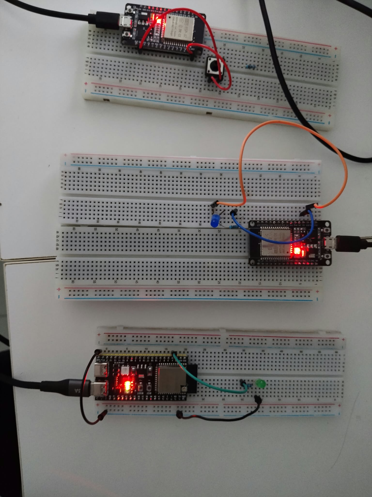

# Laboratory Activity 7: Master-Slave BLE Communication (ESP32)

An implementation of Bluetooth Low Energy (BLE) point-to-multipoint communication using three ESP32 microcontroller boards[cite: 6, 7]. A central Master node tracks a tactile pushbutton input and transmits state commands over BLE to coordinate output states across two peripheral Slave nodes simultaneously[cite: 6, 7, 8].

---

## Group Information & Member Roles

- **Group Name:** BSCA_IDK
- **Master Node:** Caleb Viliganilao
  - *Role & Contribution:* Master BLE client architecture, connection/reconnection logic, tactile button debounce implementation, and repository configuration[cite: 8].
- **Slave 1 Node:** Caleb Viliganilao
  - *Role & Contribution:* Slave 1 BLE server advertisement configuration, characteristic write handling, and LED circuit wiring[cite: 8].
- **Slave 2 Node:** Guido Manfred Mejos
  - *Role & Contribution:* Slave 2 BLE server setup, unique UUID mapping, output validation, and hardware testing[cite: 8].

---

## Hardware Configuration & Pinout

### Master Node
- **Microcontroller:** ESP32 DevKit V1[cite: 7]
- **Input:** Tactile Pushbutton connected to `GPIO 18` with internal pull-up (`INPUT_PULLUP`)[cite: 1, 7].

### Slave Nodes (Slave 1 & Slave 2)
- **Microcontroller:** ESP32 DevKit V1 (x2)[cite: 7]
- **Output:** LED connected to `GPIO 4` with a current-limiting resistor[cite: 2, 3, 7].

| Device | Network Role | Hardware Pin | Configuration / Mode |
| :--- | :--- | :--- | :--- |
| **ESP32 Master** | BLE Client (Central)[cite: 6, 8] | `GPIO 18`[cite: 1] | Active-LOW Pushbutton (`INPUT_PULLUP`)[cite: 1, 7] |
| **ESP32 Slave 1** | BLE Server (Peripheral)[cite: 6, 8] | `GPIO 4`[cite: 2] | Digital Output LED (`HIGH` = ON, `LOW` = OFF)[cite: 2, 7] |
| **ESP32 Slave 2** | BLE Server (Peripheral)[cite: 6, 8] | `GPIO 4`[cite: 3] | Digital Output LED (`HIGH` = ON, `LOW` = OFF)[cite: 3, 7] |

---

## BLE System Architecture & UUID Map

The Master scans and connects to both peripheral devices using their assigned Service and Characteristic UUIDs[cite: 6, 8].

| Device | Advertised Name | Service UUID | Characteristic UUID | Properties |
| :--- | :--- | :--- | :--- | :--- |
| **Slave 1** | `BCA188-Slave-1` | `2b92513e-afed-40ac-afa6-e54c63acdceb`[cite: 2] | `ea3d7c32-0013-4447-8f7b-47b959b5cddc`[cite: 2] | Read, Write[cite: 2] |
| **Slave 2** | `BCA188-Slave-2` | `2b92513e-afed-40ac-afa6-e54c63acdcec`[cite: 3] | `ea3d7c32-0013-4447-8f7b-47b959b5cddc`[cite: 3] | Read, Write[cite: 3] |
| **Master** | `BCA188-Master-Central` | *Initiates discovery*[cite: 6, 8] | *Transmits command byte (`'1'` / `'0'`)*[cite: 1, 2, 3] | Client[cite: 6, 8] |

---

## Circuit Interfaces

### Complete System Hardware Setup (Master and Dual Slaves)

*The photo above illustrates the testbed setup: the central Master ESP32 wired with the active-LOW pushbutton on GPIO 18, and both Slave ESP32 boards wired with their respective indicator LEDs on GPIO 4.*

---

## Video Demonstration file

https://drive.google.com/drive/folders/1v8I0pMGEIcOO6iWJEL-duFKVCbgz7XWr?usp=sharing
